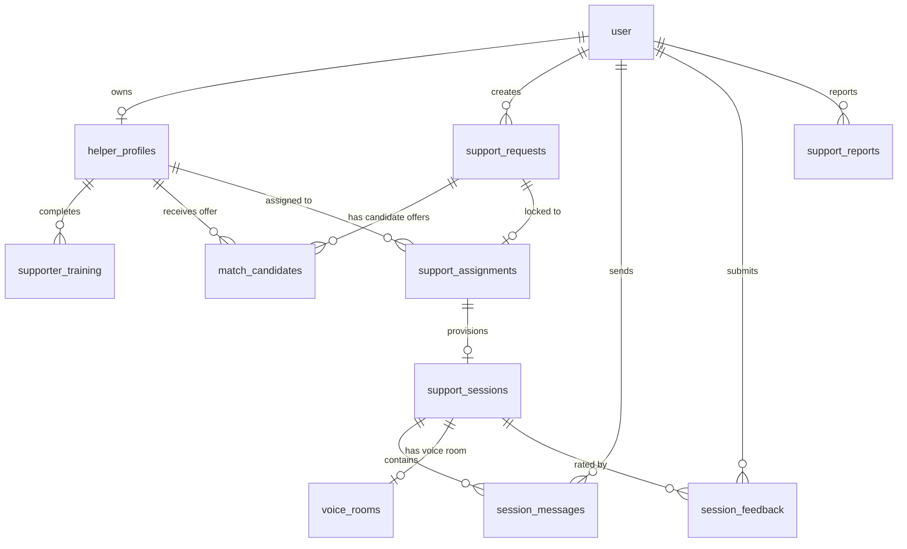

# VISTARAZ — PHASE 4: DATABASE SCHEMA SPECIFICATION
## Neon Serverless PostgreSQL Data Models & Constraints

**Platform:** Vistaraz (https://vistaraz.in)  
**Database:** Neon Serverless PostgreSQL (`ep-cold-snow-bc7rciek`)  
**Migrations Applied:** 9 (`001` through `009`)  
**Public Schema Tables:** 24 verified  
**Status:** Validated

---

## 1. Schema Overview

The database uses Neon Serverless PostgreSQL with strict snake_case column names, relational foreign key constraints, default UUID identifiers (`gen_random_uuid()`), and performant indexes on query hot-paths.



---

## 2. Table Definitions

### 2.1 `helper_profiles` (Extended)
Operational listener profile storing credentials, active capacity, and scope.

```sql
CREATE TABLE helper_profiles (
    id UUID PRIMARY KEY DEFAULT gen_random_uuid(),
    user_id TEXT NOT NULL UNIQUE REFERENCES "user"(id) ON DELETE CASCADE,
    display_alias VARCHAR(80),
    introduction TEXT,
    qualification TEXT,
    languages TEXT[] NOT NULL DEFAULT ARRAY['en'],
    verification_status VARCHAR(32) NOT NULL DEFAULT 'pending'
        CHECK (verification_status IN ('pending', 'under_review', 'approved', 'verified', 'rejected', 'suspended', 'revoked')),
    application_status VARCHAR(32) NOT NULL DEFAULT 'submitted'
        CHECK (application_status IN ('draft', 'submitted', 'under_review', 'approved', 'rejected')),
    availability_status VARCHAR(20) NOT NULL DEFAULT 'offline'
        CHECK (availability_status IN ('offline', 'available', 'busy', 'paused')),
    max_active_sessions INTEGER NOT NULL DEFAULT 1
        CHECK (max_active_sessions BETWEEN 1 AND 5),
    training_status VARCHAR(30) NOT NULL DEFAULT 'not_started'
        CHECK (training_status IN ('not_started', 'in_progress', 'completed')),
    safeguarding_approved BOOLEAN NOT NULL DEFAULT FALSE,
    supported_age_bands TEXT[] NOT NULL DEFAULT ARRAY['18-20', '21-25'],
    supported_categories TEXT[] NOT NULL DEFAULT ARRAY['general_wellbeing', 'stress', 'anxiety', 'loneliness'],
    supported_modes TEXT[] NOT NULL DEFAULT ARRAY['text', 'voice'],
    availability JSONB NOT NULL DEFAULT '{"is_online": false, "active_days": ["Mon","Tue","Wed","Thu","Fri"], "hours": "10:00-18:00"}'::jsonb,
    review_notes TEXT,
    verified_by TEXT REFERENCES "user"(id) ON DELETE SET NULL,
    verified_at TIMESTAMP WITH TIME ZONE,
    code_of_conduct_accepted_at TIMESTAMP WITH TIME ZONE,
    last_availability_updated_at TIMESTAMP WITH TIME ZONE,
    created_at TIMESTAMP WITH TIME ZONE NOT NULL DEFAULT CURRENT_TIMESTAMP,
    updated_at TIMESTAMP WITH TIME ZONE NOT NULL DEFAULT CURRENT_TIMESTAMP
);
```

### 2.2 `support_requests` (Extended)
Intake table capturing seeker preferences with strict privacy preservation.

```sql
CREATE TABLE support_requests (
    id UUID PRIMARY KEY DEFAULT gen_random_uuid(),
    user_id TEXT NOT NULL REFERENCES "user"(id) ON DELETE CASCADE,
    category VARCHAR(64) NOT NULL,
    concern_description TEXT,
    preferred_support_type VARCHAR(32) NOT NULL DEFAULT 'peer_helper',
    preferred_language VARCHAR(10) NOT NULL DEFAULT 'en',
    communication_mode VARCHAR(20) NOT NULL DEFAULT 'text'
        CHECK (communication_mode IN ('text', 'voice', 'both')),
    preferred_time_start TIMESTAMP WITH TIME ZONE,
    preferred_time_end TIMESTAMP WITH TIME ZONE,
    age_band VARCHAR(20) NOT NULL DEFAULT '18-20',
    privacy_mode VARCHAR(20) NOT NULL DEFAULT 'private',
    urgency VARCHAR(32) NOT NULL DEFAULT 'medium'
        CHECK (urgency IN ('low', 'medium', 'high', 'crisis')),
    status VARCHAR(32) NOT NULL DEFAULT 'matching'
        CHECK (status IN (
          'open', 'requested', 'safety_check', 'matching', 'offered', 
          'awaiting_seeker_confirmation', 'confirmed', 'matched', 
          'in_progress', 'resolved', 'closed', 'cancelled', 'escalated'
        )),
    created_at TIMESTAMP WITH TIME ZONE NOT NULL DEFAULT CURRENT_TIMESTAMP,
    updated_at TIMESTAMP WITH TIME ZONE NOT NULL DEFAULT CURRENT_TIMESTAMP
);
```

### 2.3 `match_candidates` (Candidate Offers & TTL)
Maintains candidate pool scoring and offer lifecycle with TTL expiration.

```sql
CREATE TABLE match_candidates (
    id UUID PRIMARY KEY DEFAULT gen_random_uuid(),
    request_id UUID NOT NULL REFERENCES support_requests(id) ON DELETE CASCADE,
    supporter_id UUID NOT NULL REFERENCES helper_profiles(id) ON DELETE CASCADE,
    match_score NUMERIC(5,2) NOT NULL,
    eligibility_status VARCHAR(20) NOT NULL DEFAULT 'eligible',
    offer_status VARCHAR(30) NOT NULL DEFAULT 'pending'
        CHECK (offer_status IN (
          'pending', 'offered', 'listener_accepted', 'listener_declined',
          'accepted', 'declined', 'expired', 'seeker_confirmed', 'seeker_declined', 'cancelled'
        )),
    offered_at TIMESTAMP WITH TIME ZONE,
    responded_at TIMESTAMP WITH TIME ZONE,
    expires_at TIMESTAMP WITH TIME ZONE,
    created_at TIMESTAMP WITH TIME ZONE NOT NULL DEFAULT CURRENT_TIMESTAMP,
    CONSTRAINT uq_match_candidates_req_supporter UNIQUE (request_id, supporter_id)
);
```

### 2.4 `support_assignments` (Atomic Assignment Lock)
Guarantees strictly 1 active assignment per support request.

```sql
CREATE TABLE support_assignments (
    id UUID PRIMARY KEY DEFAULT gen_random_uuid(),
    request_id UUID NOT NULL REFERENCES support_requests(id) ON DELETE CASCADE,
    supporter_id UUID NOT NULL REFERENCES helper_profiles(id) ON DELETE RESTRICT,
    seeker_user_id TEXT NOT NULL REFERENCES "user"(id) ON DELETE CASCADE,
    assignment_status VARCHAR(30) NOT NULL DEFAULT 'accepted'
        CHECK (assignment_status IN ('accepted', 'active', 'ended', 'cancelled', 'escalated')),
    accepted_at TIMESTAMP WITH TIME ZONE NOT NULL DEFAULT CURRENT_TIMESTAMP,
    ended_at TIMESTAMP WITH TIME ZONE,
    created_at TIMESTAMP WITH TIME ZONE NOT NULL DEFAULT CURRENT_TIMESTAMP,
    CONSTRAINT uq_support_assignments_request UNIQUE (request_id)
);
```

### 2.5 `support_sessions` (Active Session Entity)
```sql
CREATE TABLE support_sessions (
    id UUID PRIMARY KEY DEFAULT gen_random_uuid(),
    support_request_id UUID REFERENCES support_requests(id) ON DELETE SET NULL,
    assignment_id UUID REFERENCES support_assignments(id) ON DELETE SET NULL,
    user_id TEXT NOT NULL REFERENCES "user"(id) ON DELETE CASCADE,
    assigned_peer_id TEXT REFERENCES "user"(id) ON DELETE SET NULL,
    session_type VARCHAR(32) NOT NULL DEFAULT 'text'
        CHECK (session_type IN ('text', 'audio', 'video')),
    session_status VARCHAR(32) NOT NULL DEFAULT 'scheduled'
        CHECK (session_status IN ('scheduled', 'ready', 'active', 'in_progress', 'completed', 'cancelled', 'no_show', 'escalated')),
    scheduled_for TIMESTAMP WITH TIME ZONE,
    started_at TIMESTAMP WITH TIME ZONE,
    ended_at TIMESTAMP WITH TIME ZONE,
    created_at TIMESTAMP WITH TIME ZONE NOT NULL DEFAULT CURRENT_TIMESTAMP,
    updated_at TIMESTAMP WITH TIME ZONE NOT NULL DEFAULT CURRENT_TIMESTAMP
);
```

### 2.6 `session_messages` (Private Chat)
```sql
CREATE TABLE session_messages (
    id UUID PRIMARY KEY DEFAULT gen_random_uuid(),
    session_id UUID NOT NULL REFERENCES support_sessions(id) ON DELETE CASCADE,
    sender_user_id TEXT NOT NULL REFERENCES "user"(id) ON DELETE CASCADE,
    message_body TEXT NOT NULL CHECK (char_length(message_body) BETWEEN 1 AND 5000),
    is_read BOOLEAN NOT NULL DEFAULT FALSE,
    created_at TIMESTAMP WITH TIME ZONE NOT NULL DEFAULT CURRENT_TIMESTAMP,
    deleted_at TIMESTAMP WITH TIME ZONE
);
```

### 2.7 `voice_rooms` (WebRTC Rooms)
```sql
CREATE TABLE voice_rooms (
    id UUID PRIMARY KEY DEFAULT gen_random_uuid(),
    session_id UUID NOT NULL UNIQUE REFERENCES support_sessions(id) ON DELETE CASCADE,
    provider VARCHAR(64) NOT NULL DEFAULT 'webrtc_standard',
    provider_room_id VARCHAR(255) NOT NULL,
    room_status VARCHAR(20) NOT NULL DEFAULT 'created'
        CHECK (room_status IN ('created', 'active', 'closed')),
    created_at TIMESTAMP WITH TIME ZONE NOT NULL DEFAULT CURRENT_TIMESTAMP,
    closed_at TIMESTAMP WITH TIME ZONE
);
```

### 2.8 `session_feedback`, `support_reports`, `safeguarding_cases`
- `session_feedback`: Enforces unique constraint `(session_id, submitted_by)`. Rating: 1–5.
- `support_reports`: Incident reporting with report types: `inappropriate_behavior`, `boundary_violation`, `harassment`, `safety_concern`, `other`.
- `safeguarding_cases`: Case records for youth safeguarding and acute crisis incidents.
