# VISTARAZ — PHASE 4: IMPLEMENTATION PLAN
## Human Peer Support & Intelligent Matching Infrastructure

**Platform:** Vistaraz (https://vistaraz.in)  
**Technology Baseline:** React 19, Vite, Node.js, Express 5, Better Auth, Neon Serverless PostgreSQL  
**Active Development Branch:** `Dev`  
**Priority:** High  
**Status:** In Execution

---

## 1. Baseline Environment Record

As required by Section 2 of the Phase 4 Developer Implementation Specification:

- **Active Git Branch:** `Dev`
- **Base HEAD Commit:** `eccc3ae` (`feat(phase-4): human peer support infrastructure, intelligent matching, and safeguarding gates`)
- **Working Tree Status:** Clean (no uncommitted tracked modifications)
- **Database Migrations Recorded (NeonDB):** 9 migrations applied:
  1. `001_create_better_auth_tables.sql`
  2. `002_create_profiles_and_roles.sql`
  3. `003_create_helper_and_professional_profiles.sql`
  4. `004_create_support_tables.sql`
  5. `005_create_assessment_and_audit_tables.sql`
  6. `006_add_seeker_profile_fields.sql`
  7. `007_create_intern_applications_and_admin_support.sql`
  8. `008_create_community_tables.sql`
  9. `009_create_peer_support_infrastructure.sql`
- **Total Tables in Public Schema:** 24 tables verified.
- **Roles Defined:** `user`, `helper`, `professional`, `admin`, `intern`, `safeguarding_lead`.

---

## 2. Workstream Breakdown & Roadmap

```mermaid
flowchart TD
    subgraph P4-A: Foundation & Database
        A1[Audit Existing NeonDB Tables] --> A2[Verify Additive Constraints]
        A2 --> A3[Ensure Backward Compatibility]
    end

    subgraph P4-B: Listener Onboarding & Availability
        B1[Helper Profile Retrieval & Updates] --> B2[Availability & Capacity Management]
        B2 --> B3[Admin Approval & Suspension Workflow]
    end

    subgraph P4-C: Matching & Mutual Confirmation
        C1[10 Hard Eligibility Filters] --> C2[100-pt Explainable Ranking]
        C2 --> C3[Single-Offer Dispatch with 10m TTL]
        C3 --> C4[Listener Acceptance -> Temporary Reservation]
        C4 --> C5[Seeker Confirmation API -> Atomic Assignment]
    end

    subgraph P4-D: Private Text Support
        D1[Session Authorization Verification] --> D2[Private Message Persistence]
        D2 --> D3[Ended Session Message Rejection]
    end

    subgraph P4-E: Scheduled Voice Support
        E1[Scheduled Voice API Endpoint] --> E2[Ephemeral Participant Tokens]
        E2 --> E3[STUN/TURN WebRTC Integration]
    end

    subgraph P4-F: Safeguarding & Quality Assurance
        F1[Explicit Minor Gate Flag: false] --> F2[Immediate Crisis Intervention Intercept]
        F2 --> F3[Restricted Safeguarding Permission: safeguarding_case_review]
        F3 --> F4[9 Comprehensive Test Suites]
    end

    P4-A --> P4-B --> P4-C --> P4-D --> P4-E --> P4-F
```

---

## 3. Workstream Execution Strategy

### P4-A: Database and Backend Foundation
- Inspect and verify schema constraints across `helper_profiles`, `support_requests`, `match_candidates`, `support_assignments`, `support_sessions`, `session_messages`, `voice_rooms`, `session_feedback`, `support_reports`, and `safeguarding_cases`.
- Ensure all queries use parameterized SQL and transactions for multi-step transitions.

### P4-B: Listener Onboarding and Availability
- Route paths: Both `/api/supporters/*` and `/api/listeners/*` supported seamlessly.
- Enforce that listeners cannot self-verify or self-approve training modules.
- Ensure only verified/approved listeners with completed training can toggle `available`.

### P4-C: Matching and Mutual Confirmation
- Enforce the 2-step mutual acceptance rule:
  1. Listener accepts $\to$ Request status: `awaiting_seeker_confirmation`, offer status: `listener_accepted`.
  2. Seeker accepts via `POST /api/support-requests/:id/confirm-match` $\to$ Atomic transaction creates `support_assignments` and initializes `support_sessions`.
  3. If seeker declines $\to$ Offer status: `seeker_declined`, release reservation, trigger automatic rematching.

### P4-D: Private Text Support
- Enforce strict participant authorization (`isSeeker || isSupporter`).
- Validate message length (1–5,000 characters).
- Prevent IDOR: unassigned users or guessed session IDs return 403 / 404 without leaking data.

### P4-E: Scheduled Voice Support
- Implement `/api/sessions/:id/voice/schedule` to book future voice sessions with valid timestamps.
- Implement `/api/sessions/:id/voice/join-token` providing HMAC-signed short-lived tokens and standard STUN configuration.
- Recording disabled by default.

### P4-F: Safeguarding, Administration & QA
- Enforce `MINOR_LIVE_SUPPORT_ENABLED=false` on backend and frontend.
- Standardize age-bands: `'15_17'`, `'18_20'`, `'21_25'` (and `'15-17'`).
- Restrict safeguarding endpoints to users with `safeguarding_case_review` or `admin`.
- Execute all 9 test suites and document results.
