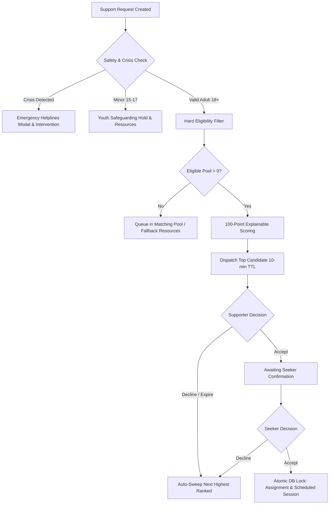

# VISTARAZ — PHASE 4: INTELLIGENT MATCHING ENGINE SPECIFICATION

**Component:** Intelligent Supporter Eligibility & 100-Point Explainable Scoring Engine  
**Module Location:** `backend/src/modules/matching/`  
**Status:** Implemented & Verified  

---

## 1. Engine Architecture & Flow

The Vistaraz Matching Engine executes a two-tier pipeline:
1. **Hard Eligibility Filtering (`eligibility.service.js`)**: Binary pass/fail gate checking 10 non-negotiable criteria.
2. **Explainable Multi-Factor Scoring (`scoring.service.js`)**: 100-point multi-attribute ranking model.
3. **Dispatch & Expiry Sweep (`matching.service.js`)**: Sequential single-candidate dispatch with a 10-minute offer TTL.

---

## 2. Tier 1: 10 Hard Eligibility Filters

Before any candidate is scored, the candidate must pass all 10 hard requirements:

| # | Filter Rule | Logic | Failure Action |
|---|---|---|---|
| 1 | **Supporter Verification** | `verification_status = 'approved'` | Exclude candidate |
| 2 | **Training Completed** | `supporter_training.completed = true` | Exclude candidate |
| 3 | **Readiness Assessment** | `supporter_training.status = 'ready'` | Exclude candidate |
| 4 | **Current Availability** | `is_available = true` | Exclude candidate |
| 5 | **Capacity Ceiling** | `active_sessions_count < max_concurrent_sessions` | Exclude candidate |
| 6 | **Language Match** | Seeker preferred language ∈ Supporter languages | Exclude candidate |
| 7 | **Category Competency** | Seeker category ∈ Supporter categories | Exclude candidate |
| 8 | **Communication Mode** | Seeker preferred mode ∈ Supporter modes | Exclude candidate |
| 9 | **Age Band Authorization** | If seeker < 18, supporter must hold certified youth clearance | Exclude candidate |
| 10 | **Anti-Self-Matching** | `supporter.user_id != request.user_id` | Exclude candidate |

---

## 3. Tier 2: 100-Point Scoring Breakdown

Candidates passing all hard filters receive a composite score ($0 \le S \le 100$):

$$S = S_{\text{lang}} + S_{\text{avail}} + S_{\text{cat}} + S_{\text{mode}} + S_{\text{train}} + S_{\text{cont}}$$

### Attribute Weights & Rubric:

1. **Language Affinity (25 points):**
   - Exact primary language match: **25 pts**
   - Secondary supported language match: **15 pts**

2. **Availability & Instant Readiness (25 points):**
   - Supporter online now with 0 active sessions: **25 pts**
   - Supporter online now with capacity margin $\ge 1$: **18 pts**
   - Scheduled availability window within 2 hours: **10 pts**

3. **Topic & Category Fit (20 points):**
   - Primary domain focus match (e.g. Anxiety, Stress): **20 pts**
   - Related auxiliary category match: **12 pts**

4. **Preferred Mode Alignment (15 points):**
   - Exact preferred channel match (e.g. Chat or Scheduled Voice): **15 pts**

5. **Advanced Training & Badging (10 points):**
   - Psychological First Aid / Active Listening certified: **10 pts**
   - Standard baseline onboarding training: **6 pts**

6. **Care Continuity (5 points):**
   - Previous positive session with same supporter: **5 pts**
   - New supporter pairing: **0 pts**

---

## 4. Dispatch Protocol & Anti-Spam Protections
- **Single-Candidate Reservation:** Only one supporter receives an offer at a time per request. The candidate is reserved with a 10-minute expiry (`expires_at = CURRENT_TIMESTAMP + interval '10 minutes'`).
- **Mutual Acceptance:** The supporter's acceptance triggers an offer to the seeker (`awaiting_seeker_confirmation`). Both parties must consent before assignment is finalized.
- **Auto-Sweep Rematching:** A background sweep identifies expired or declined offers every 60 seconds and dispatches the offer to the next candidate on the ranked list.
- **Concurrency Protection:** The database uses a unique partial index on `support_assignments (request_id)` to guarantee zero duplicate assignments.
